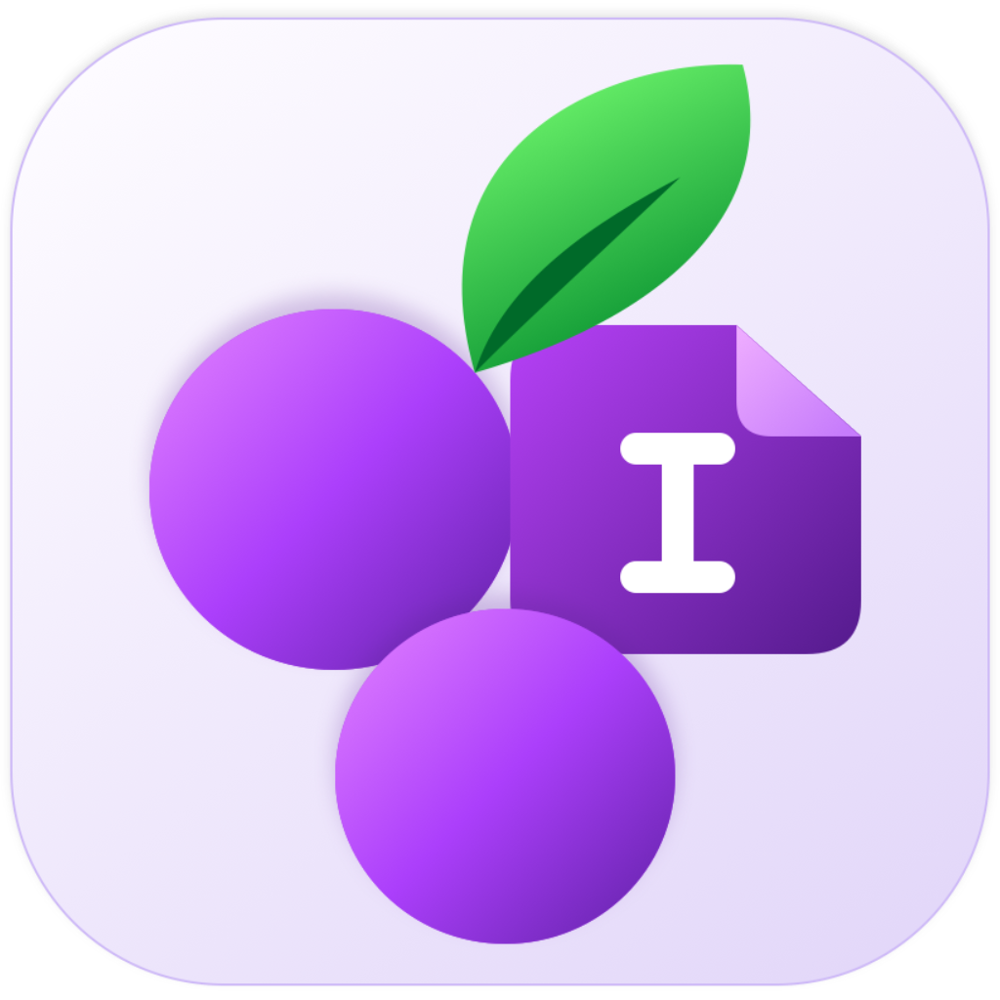
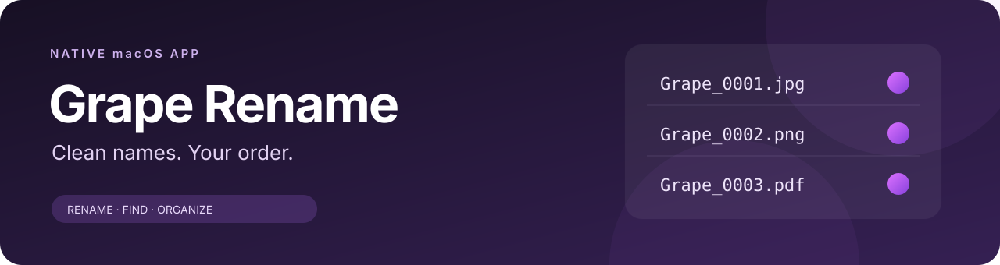
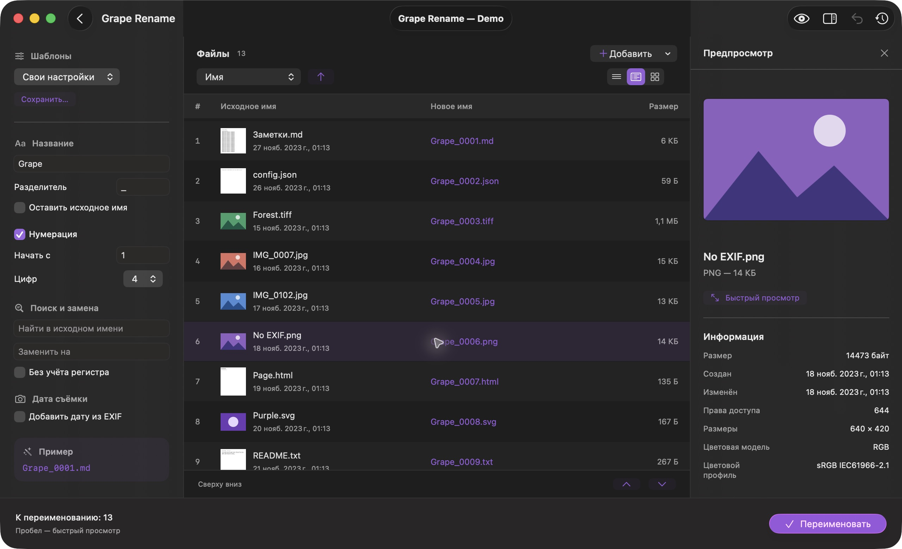
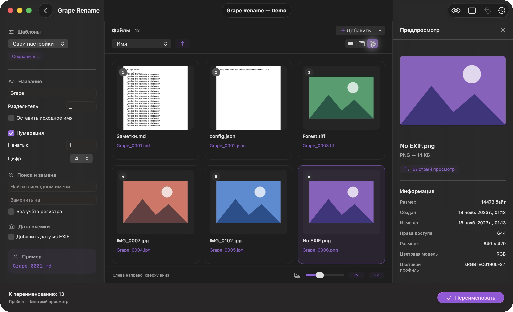
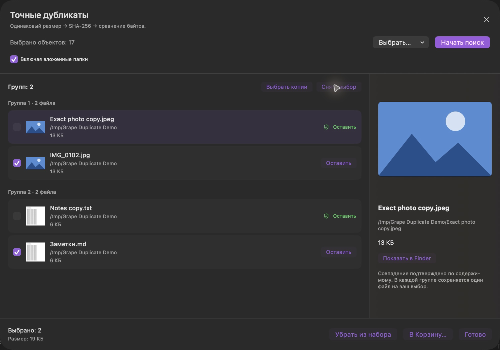
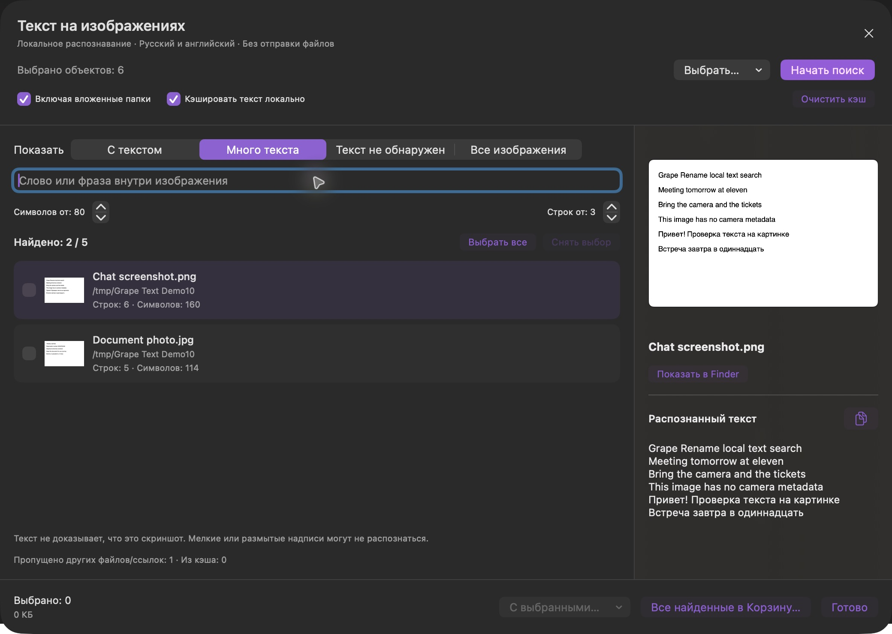

<p align="center"></p>

<p align="center"></p>

<p align="center">


</p>


<p align="center">
<a href="https://github.com/hikanioblack-dot/grape-rename/releases/latest/download/Grape-Rename.dmg"></a>
</p>

<p align="center"><a href="README.md">Русский</a> · <b>English</b> · <a href="https://github.com/hikanioblack-dot/grape-rename/releases">Releases</a> · <a href="https://github.com/hikanioblack-dot/grape-rename/issues/new/choose">Report a bug</a></p>

# Clean names. Your order.

**Grape Rename** is a native macOS app for batch renaming. Choose files, arrange them, preview the resulting names and rename the whole batch with one click.

We would love you to try it and tell us how it fits your workflow. Photos, scans, documents and project materials are easier to manage with clear names and consistent numbering.



## Why use Grape Rename?

| Your task | How the app helps |
| --- | --- |
| Organize a batch | Apply a common name and numbering from `0001` in your chosen order. |
| Check the result first | See current and proposed names side by side before renaming. |
| Arrange photographs | Use large thumbnails, a grid, sorting and drag and drop. |
| Preserve original dates | Rename without rewriting contents; file modification dates are preserved. |
| Restore previous names | Undo from persistent history, even after restarting the app. |
| Repeat a workflow | Save naming settings as reusable presets. |

## Available now

- Choose files or folders in Finder; drag in additional files.
- Prefix, separator, original name, start number, digit count and optional numbering.
- Sort by name, type, size, creation date, modification date or EXIF capture date.
- Manual order with an insertion line in compact and thumbnail lists.
- Compact rows, a thumbnail list and a grid with adjustable thumbnail sizes.
- Literal find and replace with optional case-insensitive matching.
- EXIF capture dates in names; no substituted date when EXIF is missing.
- **Space** for Quick Look, arrow navigation and a live sidebar preview.
- Read-only file metadata, image dimensions, camera details and EXIF when available.
- Saved presets, persistent rename history and **⌘Z** undo.
- Name conflict checks and protection against overwriting existing files.
- English and Russian, following the system language.

<details>
<summary><b>View the thumbnail grid</b></summary>



</details>

## Tools: duplicates and similar photos

The **Tools** menu offers two separate searches. Files from the main list are selected initially; you can choose other files or folders in the search window. Folder scans can include subfolders. Hidden files and symbolic links are skipped; multiple hard links to the same file count once.

**Exact duplicates:** size filtering, streaming SHA-256 and byte-for-byte verification. Names, extensions and dates may differ.

**Similar photos:** a perceptual image hash combined with Apple Vision, with strict, balanced and broader matching. This helps locate resized, recompressed and related images, but does not prove identical content. Each member is compared with its group's first image. Similar photos require manual review.

Search runs locally in the background, reports progress and can be stopped. Unreadable and corrupt files are listed separately. One file in each group is marked **Keep**, and you can change it. Nothing is selected initially. In exact search, **Move All Copies to Trash…** selects every file except those marked **Keep**, then asks for confirmation with the file count. To remove individual files, check their boxes and click **Move Selected to Trash…**.

**Remove from Batch** excludes selected files from renaming without changing the files on disk. **Move to Trash** requests confirmation and checks for changes since the scan. Restore trashed files in Finder; rename undo does not restore them. The displayed size is the sum of selected file sizes, not guaranteed reclaimed disk space.

The main window opens immediately. Prefix, numbering and the naming example stay visible; presets, find and replace and EXIF settings are in collapsible **Advanced** sections at the bottom of the left sidebar.



## Text in images

Open **Tools → Find Text in Images…** to scan images or folders locally with Apple Vision. No metadata is needed. Recognition supports Russian and English; only the first page/frame of multipage or animated images is scanned. Unreadable images are listed separately.

Switch between **With Text**, **Lots of Text**, **No Text Detected** and **All Images** without rescanning. Adjust the minimum non-whitespace character and line counts for Lots of Text. Search for a word or phrase without case sensitivity. The right sidebar shows a preview and recognized text, with a copy button.

Text does not prove an image is a screenshot. Document photos also contain text, and small or blurry text may be missed. No Text Detected is not a guarantee that an image contains no writing.

Check files and use **Selected Files…** to copy or move them to a folder, or move them to Trash. Existing destination names are never overwritten. **All Matches to Trash…** targets only the current filter and query results and asks for confirmation with the count. Unlike duplicate search, no copy is protected: these are the original matching images. Files are checked for changes before actions. Restore trashed files in Finder; rename history does not undo moving or deleting images.

Scanning runs in the background and can be stopped. Optional local caching stores recognized text; disable it or use **Clear Cache** to delete it. Files and text are never uploaded. Scanning preserves image contents and modification dates.



## Download and install

**Current release: 1.0.10, build 10.** Requires macOS Tahoe 26+ and an Apple Silicon Mac.

1. [Download Grape-Rename.dmg](https://github.com/hikanioblack-dot/grape-rename/releases/latest/download/Grape-Rename.dmg).
2. Open the DMG and drag **Grape Rename.app** into **Applications**.
3. Launch from Applications. Replace the previous copy when updating.

Free to download without signing in. Each release includes `SHA256SUMS.txt`.

This build uses an ad-hoc signature and does not yet have Developer ID signing or Apple notarization. macOS may show a developer verification warning. Signed and notarized releases are part of our plans.

## More to come — including Windows

We will keep updating Grape Rename, refining the interface, fixing bugs and adding features. **We also plan to bring the app to Windows** so more people can use it.

We want to explore additional naming rules, multiple-file selection, preset sharing, update checks and easier installation. Windows is planned; the current DMG is for macOS. Release scope and timing will be announced as development progresses.

[Suggest a feature](https://github.com/hikanioblack-dot/grape-rename/issues/new/choose) and help us decide what to build next.

## Try it. Tell us what you think.

We welcome usability feedback, feature ideas and **bug reports**. [Open an Issue](https://github.com/hikanioblack-dot/grape-rename/issues/new/choose) with your app and macOS versions, steps to reproduce, expected behavior and actual behavior. A screenshot can help; avoid attaching personal files.

Thank you for helping us improve Grape Rename. Follow new versions with **Watch → Custom → Releases** on GitHub.

## Source and building

Swift, SwiftUI, AppKit and Quick Look. No third-party libraries or telemetry. History and presets stay on your Mac.

Requires macOS 26+ and Command Line Tools with Swift 6.3 and the macOS 26 SDK:

```sh
zsh build.sh
```

The script creates the app, ZIP, DMG and checksum in `dist/`, applies an ad-hoc signature and runs checks in both languages. Checks cover bytes and timestamps, persistent undo, name conflicts, import, sorting, EXIF and interrupted-operation recovery.

[Detailed guide in Russian](docs/USER_GUIDE.ru.md) · [Changelog](CHANGELOG.md)

Renaming can change the parent folder's modification date and system metadata time (`ctime`). The file's own modification date is preserved.
